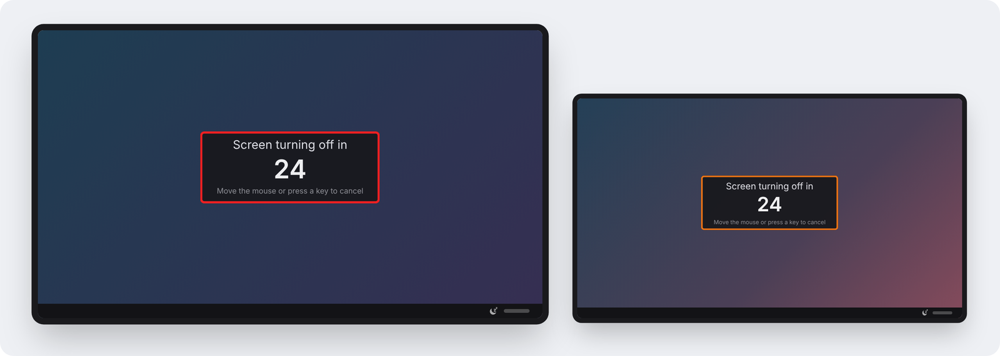
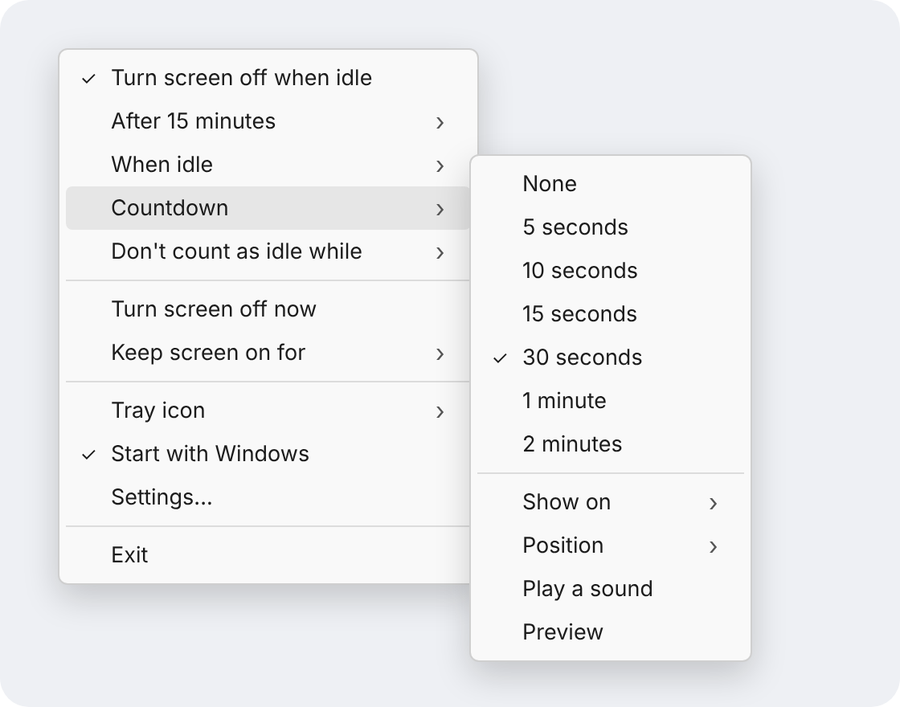
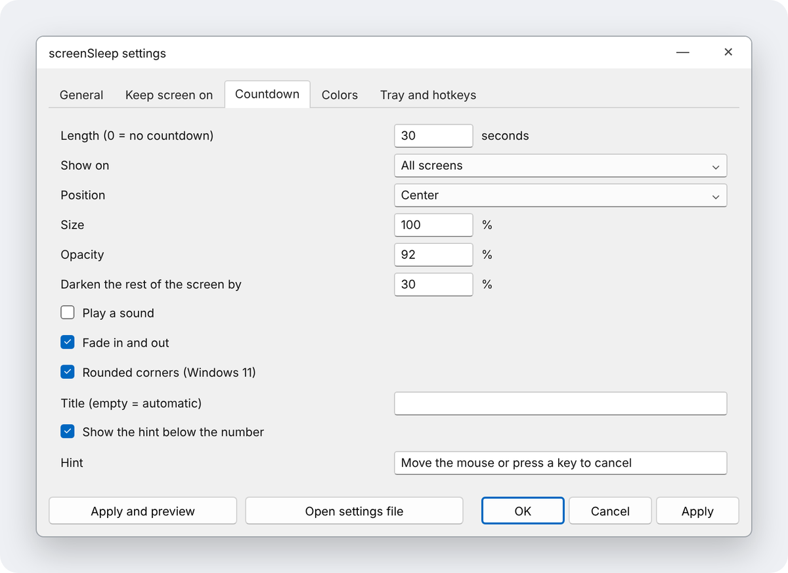
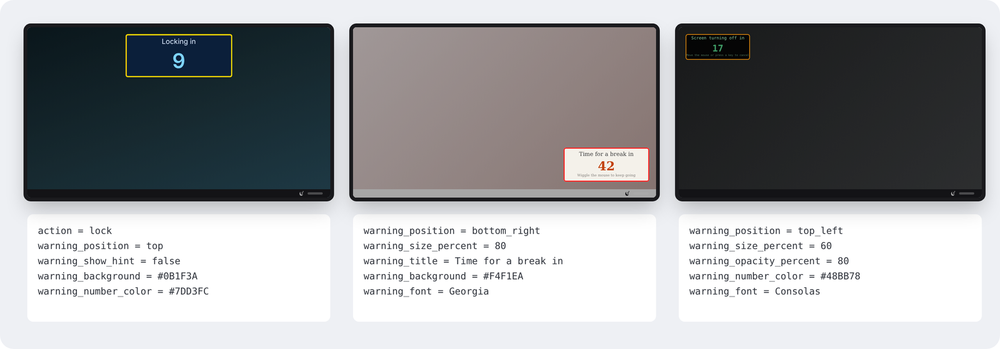
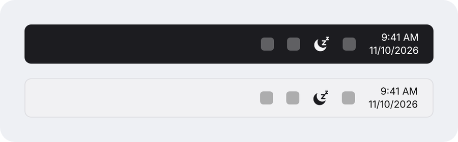

# Screen sleep

A tiny Windows tray utility that turns the screen off after a period of
inactivity. Thirty seconds beforehand it shows a countdown; moving the mouse or
pressing a key cancels it.

Version 2 is a rewrite of the original C#/WinForms app in Rust. It is a single
small `.exe` with no runtime to install, for Windows 10 and 11. See the
[changelog](CHANGELOG.md) for what is new.

*The pictures in this README are illustrations drawn from the app's layout
and default settings, not screenshots.*

## Using it

Run `screensleep.exe`. It appears as an icon in the system tray; click it for
the menu:

- **Turn screen off when idle**: the main on/off switch.
- **After ...**: how long to wait.
- **When idle**: what to do at that point: turn the screen off, lock, lock
  and turn the screen off, start the screen saver, sleep or hibernate.
- **Countdown**: its length (or none), which screens it shows on (all of
  them by default), where it appears, whether it plays a sound, and a
  **Preview** that shows it for ten seconds.
- **Don't count as idle while**: music or video is playing, a full-screen app
  is in front, or the cursor is parked against a screen edge.
- When something is keeping the screen on, the top of the menu says what. If
  you come back to a screen that stayed on, it says what last kept it on and
  until when.
- **Turn screen off now**
- **Keep screen on for ...**: holds the screen on for a set time, whatever
  else is configured.
- **Tray icon**: light, dark, or matching the taskbar.
- **Start with Windows**
- **Settings...**: opens the settings window, which has everything.

## Settings

**Settings...** in the menu opens a window with every setting, grouped into
tabs. **Apply and preview** applies your changes and shows the countdown for
ten seconds, which is the quick way to tune how it looks.

The same settings live in a text file,
`%APPDATA%\screenSleep\settings.ini` (**Open settings file** in the window).
Every setting in it has a comment, and edits apply the moment you save. If a
line can't be understood, a notification says which one and why, and that
setting keeps its default.

| Group | What you can change |
| --- | --- |
| General | Action at timeout; timeout; a separate timeout on battery; a daily schedule (e.g. only 22:00-07:00); whether to hold off Windows' own display timeout; the delay before "Turn screen off now"; how long "keep screen on" lasts |
| Keeping the screen on | Media playing, how long sound must last to count (so chimes are ignored), and programs whose sound to ignore (a voice call, say); game controllers; full-screen apps; which screen edges hold it on; a list of programs that hold it on while running |
| Language | English, Spanish, German or French; follows Windows by default |
| Countdown | Length; sound; fade in and out; rounded corners; darkening the rest of the screen; position; which monitors (all, the one with the cursor, or the main one); size; opacity; background, text and number colours; the pulsing outline (on/off, its two colours, thickness, speed); font; the title and hint text; whether the hint shows |
| Tray | Icon colour; what left-click and middle-click do; notifications; which timeouts the menu offers |
| Hotkeys | Global shortcuts to switch screenSleep on/off, turn the screen off now, and start/stop keeping the screen on |
| Troubleshooting | A debug log of what screenSleep decided and why |

A few examples of what the countdown settings can do, with the lines that
produce each:

Some notes on behaviour:

- Media is detected by sound output, so a silent or muted video does not
  count. Sound has to be continuous for `media_min_seconds` (2 by default).
- Game controllers count as input (Windows itself ignores them), so the
  timeout won't hit mid-game. This covers XInput controllers, which includes
  Xbox pads and most others when used through Steam.
- Anything that holds the screen on counts as activity, the same as touching
  the mouse: once it ends, the full timeout runs, countdown included.
- While it is switched on, screenSleep holds off Windows' own display timeout
  (and with it the screen saver), so its timeout is the one that applies. Set
  `block_windows_timeout = false` to let whichever is shorter win.

The tray icon follows the taskbar by default: a light icon on a dark taskbar
and a dark one on a light taskbar, switching when the Windows theme changes.

## Building

Install [Rust](https://rustup.rs) on Windows, then:

    cargo build --release

The result is `target\release\screensleep.exe`. Pushing to GitHub also builds
it via the included Actions workflow, and pushing a version tag (`v2.0.0`)
publishes a release with 64-bit and ARM64 builds and their checksums.

The `.exe` is not code-signed, so Windows SmartScreen will warn the first
time it is run: choose "More info", then "Run anyway".

`cargo test` runs the tests for the timing logic and settings file, and works
on any OS.

## Upgrading from 1.x

Settings are imported automatically. Version 1 moved itself into
`%APPDATA%\screenSleep\`; version 2 runs from wherever you put it, and if
"Start with computer" was on, it repoints that at itself the first time it
runs. Exit the old version first; its leftover
`%APPDATA%\screenSleep\screenSleep.exe` can then be deleted.

## Layout

- `src/policy.rs`: decides between active / countdown / off. No OS calls.
- `src/config.rs`: the settings file.
- `src/hotkey.rs`: parses hotkey descriptions.
- `src/media.rs`: detects sound output.
- `src/lang.rs`: translations.
- `src/schema.rs`: which settings appear where in the settings window.
- `src/settings.rs`: the settings window.
- `src/win.rs`: tray icon, menu, countdown window, Win32 calls.

## Licence

[MIT](LICENSE).
